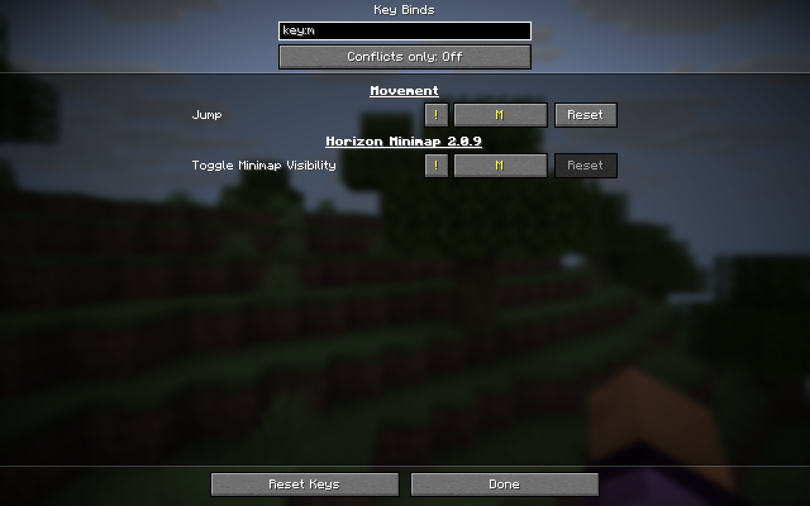

# Horizon Keybind Manager

Search key binds and fix conflicts between game controls and native mods in Horizon Minecraft 26.3.

[Download v0.1.0](https://github.com/maliferen/horizon-keybind-manager/releases/tag/v0.1.0) · [Русский](README.ru.md)

## Features

Open **Options → Controls → Key Binds**.

- Search by action, mod, or assigned keyboard or mouse button. Type `key:M` to find the exact key.
- Use **Conflicts only** to see overlapping bindings. The yellow **!** jumps to the next action on that key.
- Rebind or reset game and native mod keys from the same list. The game saves changes as usual.

The filter starts off each time the screen opens. To disable the mod, turn it off in the launcher's **Native mods** list and rebuild the instance.

## Installation

1. Download `horizon_keybind_manager-0.1.0.hnmod` from [Releases](https://github.com/maliferen/horizon-keybind-manager/releases).
2. Put the file in your instance's `horizon-native-mods/` directory and enable it in the Horizon launcher.
3. Build and launch the native mods instance.

## Compatibility

- Minecraft 26.3 in Horizon. Verified on Horizon revisions `2ebf00a` and `fdc87ae`.
- Runs on the client. You can use it on servers without installing it there.
- Includes English and Russian interface labels.

[MIT License](LICENSE)
